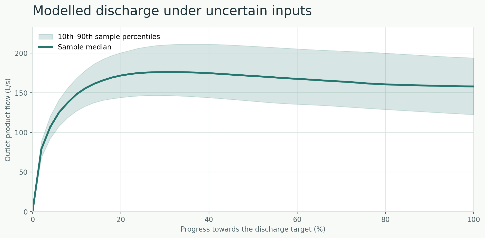

# Pipeline flow modelling

**Reproducible Python examples of air-driven pipe emptying, pressure losses and modelling uncertainty.** The work illustrates numerical methods used in a broader six-month industrial research project. Every value in this public repository is hypothetical; it contains no company test data, installation specifications, calibration results or original employer code.



*Example result — sample median and 10th–90th percentiles from 256 hypothetical Push scenarios, aligned by product-removal progress. These are not validated prediction intervals.*

## What is included

| Module | Demonstration | Scientific boundary |
| --- | --- | --- |
| **Push** | A moving liquid-column ODE with constant-pressure and isolated-gas expansion cases | Simplified, one-dimensional; not a calibrated industrial pressure forecast |
| **Geometry** | Segmented pipe volumes, elevations, Darcy–Weisbach and local losses | Steady single-phase losses; not coupled to the transient Push solver |
| **Blow** | Liquid-column transition, conservation and a separate illustrative film-decay calculation | No validated annular-flow correlations or film-stripping kinetics |
| **Uncertainty** | 256 scrambled Sobol parameter scenarios, completion times and discharge percentile bands | Invented independent input distributions; no experimental coverage guarantee |
| **Rinse / Dry** | Water and product balances, plus explicit transfer of residual water between stages | Simplified inventory models; not a complete or validated cleaning simulation |

**Important:** These are related examples, not a single fully coupled Push→Blow→Rinse→Dry industrial solver. Numerical verification and physical validation are different activities.

## Run locally

Python 3.10 or newer:

```bash
python -m pip install -e ".[dev]"
python -m pytest
python examples/push_stage_figures.py
python examples/phase5_uncertainty_figures.py
```

To regenerate all example figures:

```bash
python tools/reproduce_all.py
```

To run a conservative, automated publication preflight:

```bash
python tools/audit_release.py
```

The preflight cannot establish legal permission or detect every possible information disclosure. Manually inspect every commit before publication.

## Selected results

| Figure | Question addressed |
| --- | --- |
| [Push pressure-source comparison](figures/push-discharge-comparison.png) | How does isolated-air expansion change liquid discharge relative to a fixed driving pressure? |
| [Segmented versus equivalent pipe](figures/phase3-segmented-vs-equivalent.png) | Why does equal pipe volume not imply equal hydraulic resistance? |
| [Blow liquid-volume conservation](figures/phase4-blow-transition-volumes.png) | Where does the liquid go as the remaining full column shrinks? |
| [Push uncertainty band](figures/phase5-push-qmc-flow-band.png) | How do hypothetical input ranges propagate to calculated outflow? |
| [Rinse-to-Dry transfer](figures/phase6-rinse-dry-water-inventory.png) | How does the residual water inventory carry between simplified stages? |

All five selected charts are generated from the code. The scripts can reproduce further diagnostic plots, but only the five representative charts are committed in both PNG and SVG formats. See the [figure guide](docs/FIGURES.md).

## Project organization

```text
src/pipeline_flow/    Model equations, numerical integration and balances
examples/             Synthetic scenarios and code-generated plots
tests/                Invariants, edge cases and solver verification
figures/              Five curated results (PNG + SVG)
docs/                 Assumptions, methodological notes, publication checklist
references/           Scientific source ledger
tools/                Reproduction and release-preflight utilities
.github/workflows/    Automated tests and figure-reproduction checks
```

More details: [model limitations](docs/MODEL_SCOPE.md), [Push](docs/PHASE_2_PUSH.md), [pipe geometry](docs/PHASE_3_GEOMETRY.md), [Blow](docs/PHASE_4_BLOW.md), [uncertainty](docs/PHASE_5_UNCERTAINTY.md), and [Rinse/Dry](docs/PHASE_6_RINSE_DRY.md).

## Research basis and attribution

The moving-column model is an independent teaching-oriented implementation of published physical relationships, particularly those in Tijsseling, Hou, Bozkus and Laanearu (2016), *Improved One-Dimensional Models for Rapid Emptying and Filling of Pipelines* ([DOI](https://doi.org/10.1115/1.4031508)). Chen et al. (2024) provide public experimental context ([DOI](https://doi.org/10.1038/s41597-024-03441-7)); none of those measurements are reproduced here. Annular-flow literature is cited for context but not implemented as a validated model. See [sources](references/sources.md).

**Publication and rights:** No company-specific artefacts should be added without authorization. No software licence has been granted yet; do not assume permission to reuse this code beyond GitHub's standard terms. See the [release checklist](docs/PUBLICATION_CHECKLIST.md).
