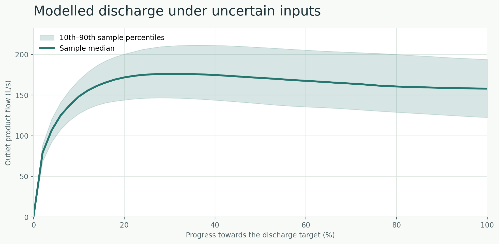

# Pipeline flow modelling

This repository presents selected mathematical models related to my six-month industrial research project on recovering liquid product from pipelines. During the original project I adapted published flow equations, developed simulations, compared calculations with measurements and investigated uncertain inputs.

The original company code, data, equipment details and calibrated results are confidential. The public repository contains separate simplified numerical examples.



*Simulated outlet flow across 256 hypothetical input combinations. The line is the median and the shaded area shows the 10th–90th sample percentiles at comparable discharge progress. These are not experimentally validated prediction intervals.*

## Numerical examples

| Topic | Implemented calculation |
| --- | --- |
| **Push** | Moving liquid column with constant or expanding-air source pressure |
| **Pipe resistance** | Pipe-section volumes, friction, elevation and local pressure losses |
| **Blow** | Liquid-column balance and a separate assumed film-removal model |
| **Uncertainty** | Scrambled Sobol sampling for four hypothetical Push inputs |
| **Rinse and Dry** | Water/product inventories and an explicit Rinse-to-Dry transfer |

The modules are not coupled into one complete or experimentally validated industrial cleaning simulator.

The individual models, their equations and limitations are explained in the [model scope](docs/MODEL_SCOPE.md), [Push](docs/PHASE_2_PUSH.md), [pipe resistance](docs/PHASE_3_GEOMETRY.md), [Blow](docs/PHASE_4_BLOW.md), [uncertainty](docs/PHASE_5_UNCERTAINTY.md) and [Rinse/Dry](docs/PHASE_6_RINSE_DRY.md).

## Selected results

The following figures were generated by Python using synthetic inputs:

- [Push discharge](figures/push-discharge-comparison.png) — constant versus expanding-air pressure
- [Pipe resistance](figures/phase3-segmented-vs-equivalent.png) — equivalent-volume geometry comparison
- [Blow volume balance](figures/phase4-blow-transition-volumes.png) — discharged and remaining liquid
- [Push uncertainty](figures/phase5-push-qmc-flow-band.png) — illustrative input uncertainty
- [Rinse to Dry](figures/phase6-rinse-dry-water-inventory.png) — water transfer between stages

See the [figure guide](docs/FIGURES.md) for details.

## Reproducibility

Python 3.10 or newer:

```bash
python -m pip install -e ".[dev]"
python -m pytest -q
python tools/reproduce_all.py
```

Models are in `src/pipeline_flow/`, standalone figure scripts in `examples/`, and mathematical checks in `tests/`. GitHub Actions runs the test suite, figure generation and a basic public-file audit.

## References

The moving-column example is based primarily on Tijsseling, Hou, Bozkuş and Laanearu (2016), [*Improved One-Dimensional Models for Rapid Emptying and Filling of Pipelines*](https://doi.org/10.1115/1.4031508). Chen et al. (2024), [*Experimental data on filling and emptying of a large-scale pipeline*](https://doi.org/10.1038/s41597-024-03441-7), provide additional scientific context; their dataset is not used. Related literature on low liquid holdup and annular flow appears in [the references](references/sources.md).

## Provenance and limitations

The public implementation was recreated **with AI assistance** from published mathematics and hypothetical parameters to illustrate selected methods from the original industrial work. It is not my original company code or an exact recreation of that installation. The tests verify equations, numerical behaviour and conservation, **not** predictive accuracy against industrial measurements.

No employer source files, measurements, calibration values or internal figures are published. No open-source licence has been assigned, so public availability does not grant general reuse rights.
